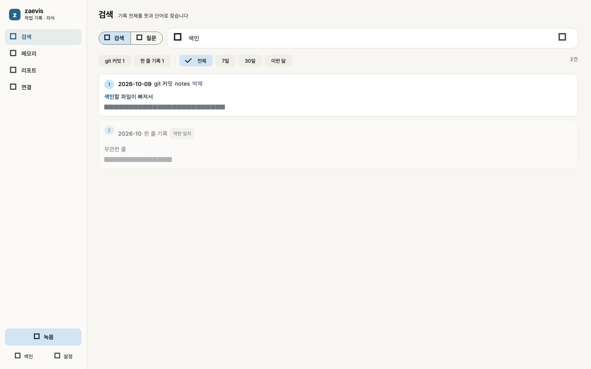
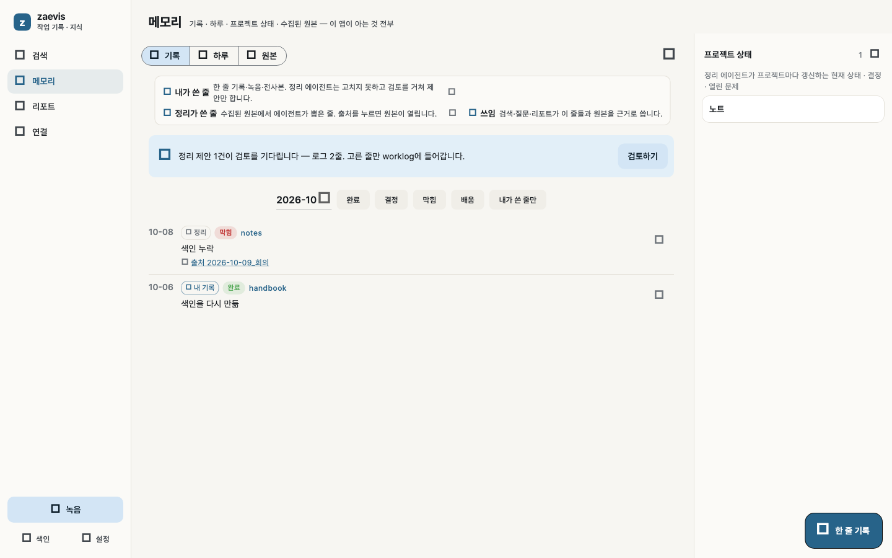
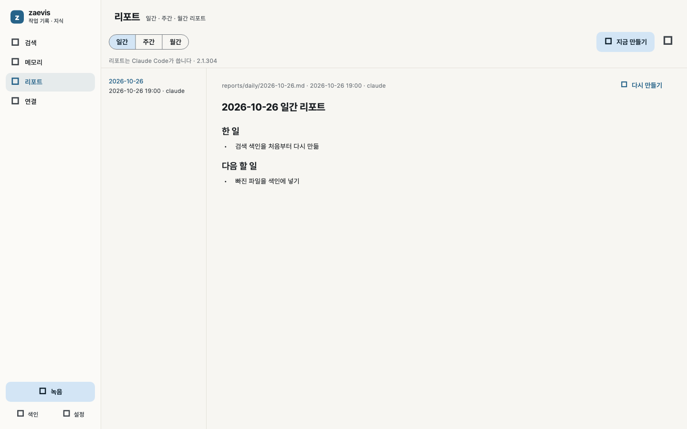
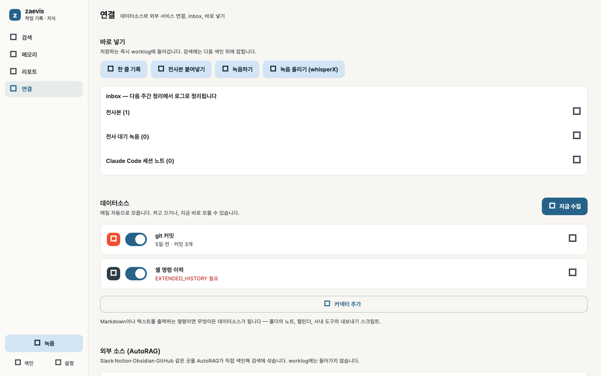

# zaevis

작업 기록을 모아 **개인 지식 베이스**로 쓰는 로컬 앱입니다.

## 화면

검색, 메모리, 리포트, 연결. 넓은 창은 왼쪽 사이드바입니다.









**수집** 매일 18:30에 git 커밋, 에이전트 세션, 셸 명령, 전사본, 커넥터를 모읍니다.

**주입** 한 줄 기록, 전사본, 녹음은 바로 저장됩니다. 녹음은 whisperX가 전사합니다. 전사는 기본으로 CPU 4코어만 써서 팬 소리를 줄이고, 설정의 "빠르게 전사"를 켜면 모든 코어를 씁니다. 글이 저장된 뒤에는 말한 사람을 `[A]`, `[B]`처럼 같은 파일에 붙이고, 차례마다 빈 줄로 나눕니다. 원문 화면에서 A, B를 누르면 이름을 붙일 수 있고 파일에 바로 반영됩니다. 화자 없이 저장된 예전 전사본은 원문 화면의 "화자 붙이기"로 남겨 둔 녹음(`processed/audio/`)을 다시 인식해 화자를 붙입니다(녹음 길이의 1/3~1/2쯤 걸림). 말이 거의 없는 화자(30초 미만, 2% 미만)는 앞뒤 화자에 합칩니다. 화자 구분은 계정 없이 이 맥에서 돌며(sherpa-onnx, pyannote와 같은 분할·화자 모델), 첫 녹음 때 화자 모델 약 33MB와 한국어 정렬 모델 약 1.2GB를 한 번 받습니다. Hugging Face에 로그인하고 동의하면 pyannote 원본을 대신 씁니다.

**검색** 로컬 [AutoRAG](https://github.com/Marker-Inc-Korea/AutoRAG) Lite입니다. 키워드와 의미 검색을 함께 씁니다. 의미 검색은 처음 켤 때 모델 1.1GB를 받으며, 설정에서 끌 수 있습니다. [Kiwi](https://github.com/bab2min/Kiwi)를 넣으면 한국어 활용형도 찾습니다. 설치 뒤에는 색인을 처음부터 다시 만듭니다.

**대화** 검색 탭 하나에서 찾기, 질문, 내려받기를 모두 합니다. 단어를 넣으면 바로 찾고, 물으면 찾은 문단만 근거로 출처 번호를 달아 답하고, "11월 2일 전사본 내려받기"처럼 말하면 그 파일을 내려받게 해 줍니다.

**리포트** 일간, 주간, 월간으로 한 일, 결정, 막힌 것, 다음 할 일을 정리합니다.

**정리** 매주 월요일에 로그와 프로젝트 상태를 갱신합니다. 이 컴퓨터의 Claude Code, Codex, Gemini CLI를 쓰고, 없으면 OpenRouter 키를 씁니다. 자동이면 할당량이 막힌 CLI는 다음으로 넘기고, 하나를 고정하면 그 하나만 씁니다.

**설정** 앱 위에 모달로 뜹니다(뒤는 어둡게). 왼쪽에서 일반·녹음·정리·검색·수집·단축키·고급을 고릅니다. 일반에는 앱 버전, 설치한 날, 업데이트 확인·업데이트 버튼, 테마(시스템·밝게·어둡게), 글자 크기, 시스템 알림이 있습니다. 테마와 글자 크기는 서버 설정에 저장되어 웹에서도 같게 보입니다.

**기록 위치** worklog는 이 저장소 밖에 있습니다. 밖으로 나가는 항목은 설정의 **검색 재정렬**뿐입니다. 켜면 검색어와 상위 문단이 OpenRouter로 갑니다.

수집과 주입이 worklog로 모이고, AutoRAG가 색인한 뒤 앱과 CLI에서 검색합니다.

## 설치

[Releases](https://github.com/zae-park/zae-vis/releases)에서 받습니다.

macOS가 앱을 손상됐다고 하면, 설치한 뒤 한 번 실행합니다.

```bash
xattr -dr com.apple.quarantine /Applications/zaevis.app
```

## 명령

```bash
zaevis search 검색 색인
zaevis ask "색인은 왜 미뤘지?"
zaevis add "#decision [[notes]] 색인을 처음부터 다시 만들기로"
zaevis log
zaevis report daily
zaevis index --refresh
zaevis collect
zaevis ingest 회의.txt 녹음.m4a
```

전체 목록은 `zaevis help`입니다. 서버는 필요할 때 `127.0.0.1:4710`에서 스스로 뜹니다.

**직접 넣기**

- 전사본은 `worklog/inbox/transcripts/`에 둡니다.
- 한 줄은 `worklog/log/YYYY-MM.md`에 적습니다.
- 형식은 worklog의 `README.md`에 있습니다.

## 메모리

- **기록** 날짜순 한 줄입니다. **내 기록**은 잠겨 있고, **정리**가 쓴 줄은 출처로 원본을 엽니다.
- **하루** 내가 쓴 줄, 그날의 원본, 정리 결과를 한 카드에 모읍니다.
- **원본** 수집 파일과 전사본입니다. 몇 줄의 근거가 됐는지 보입니다.
- **상태** 프로젝트별 현재 상태, 결정, 열린 문제입니다. 넓은 창에서는 오른쪽에 있습니다.

## 데이터소스

연결 탭에서 켜고 끕니다. 원본에 있던 토큰과 비밀번호는 저장 전에 가립니다.

| 이름 | 모으는 것 |
|---|---|
| `git` | 고른 폴더 아래 커밋. 줄마다 작성자 |
| `agent-sessions` | Claude Code, Codex, Gemini, ChatGPT 내보내기. 요청과 응답, 수정 파일, 명령 |
| `shell-history` | zsh 명령. 시각이 없어도 모으며, 친 시각까지 남기려면 **시각 기록 켜기** |
| `transcripts` | 내보낸 전사와 녹음. 녹음은 whisperX |
| 사용자 커넥터 | Markdown을 출력하는 명령. `{fromDate}` `{toDate}`를 날짜로 바꿉니다 |

**Claude 웹** 대화는 내보낸 파일을 전사본이나 커넥터로 넣습니다.

### 외부 소스

worklog에 복사하지 않고, 검색 결과에 출처로 섞습니다. **설치** 버튼이 필요한 CLI를 넣습니다. 토큰은 카드의 **토큰 값**에만 넣습니다.

| 소스 | 준비 | 입력 |
|---|---|---|
| Obsidian | 없음 | 볼트 폴더 |
| 메일 내보내기 | 없음 | mbox, eml |
| RSS | 없음 | 피드 주소 |
| Spotlight | macOS | 질의, 폴더 |
| GitHub, Gist | 토큰 | `owner/repo` |
| Slack, Notion, Discord, WhatsApp, Telegram | 각 CLI와 로그인 | 워크스페이스 또는 아카이브 |
| 카카오톡 | lazykatok | 아카이브 |
| 메일 | mailcrawl | 계정, 메일함 |
| 클라우드 드라이브 | rclone | 리모트 이름 |
| 사진, 브라우저 기록 | clawgallery, hister | 폴더 또는 주소 |

## 질문과 리포트

**찾기** 단어만 넣으면 검색 결과가 대화에 바로 나옵니다. 에이전트를 부르지 않습니다. "모두 보기"에서 출처와 기간으로 거르고, 결과 아래 "답 받기"로 같은 말에 답을 받을 수 있습니다.

**지식화 현황** 메모리 탭 맨 위와 빈 대화창에 지금 막힌 곳 하나와 버튼이 뜹니다: 검토를 기다리는 정리 제안 → 검토하기, 마지막 정리 뒤 쌓인 원본 → 지금 정리하기, 꺼진 리포트 → 리포트 설정 같은 식입니다. 그 아래 수집 → 정리 대기 → 검토 → 지식 → 리포트 다섯 단계를 숫자로 보여 줍니다. 검토 화면은 제안을 프로젝트별로 접어 묶어서, 프로젝트를 체크하면 그 로그 줄과 프로젝트 페이지가 함께 들어갑니다. 검토가 사흘 넘게 밀리면 매일 수집 뒤 알림이 다시 옵니다. 처음 설치할 때는 마법사 끝에서 "첫 정리 해 보기"로 바로 첫 정리를 돌릴 수 있습니다(안 하면 다음 월요일). 질문 답 아래에는 근거가 정리된 기록(로그·프로젝트·정리·리포트, 책갈피 표시)과 원본 중 어느 쪽이었는지 나옵니다.

**말로 하기** 입력창 옆 마이크를 누르고 말한 뒤 다시 누르면, 말이 글자로 바뀌어 그대로 보내집니다. 회의 녹음과 같은 whisperX를 이 맥에서 띄워 두고 쓰며, 짧은 말은 3초 안팎이면 글자가 됩니다(첫 번째는 모델을 띄우느라 몇 초 더). 녹음은 저장하지 않습니다. whisperX가 설치되어 있어야 합니다.

**무엇을 원하는지** 낱말 목록으로 가르지 않습니다. 보낸 줄은 바로 검색되고, 그 줄이 원하는 것(찾기만, 답, 파일)은 모델이 정합니다. OpenRouter 키를 저장했으면 Jev(OpenRouter의 `typesafe/jev-1.13`, 글을 쓰지 않고 선택지만 고르는 판단 모델, 한 번 0.3초 안팎)가 먼저 정합니다. 찾기만이면 에이전트를 부르지 않고 검색 결과에 "답 받기"를 남깁니다. 파일이면 바로 내려받기 버튼을 보여 줍니다. 특정 파일에 대한 질문이면 그 파일 전체를 근거로 넣습니다. Jev가 확신하지 못하거나 키가 없으면(기본) 답을 쓰는 에이전트가 같은 호출에서 정합니다. 따로 라우팅 호출이 없어 비용은 그대로지만, 낱말 하나를 넣어도 에이전트가 짧게 정리해 답합니다.

**질문** 상위 문단만 근거로 씁니다. "가장 최근 회의 요약"처럼 검색 문단에 없는 파일이 필요하면 에이전트가 최근 파일 목록에서 골라 그 파일 전체를 읽고 다시 답합니다(한 번만). 근거가 없으면 찾지 못했다고 답합니다. 대화는 `~/.zaevis/ask/`에 남습니다. 답을 쓰는 동안 "멈추기"를 누르면 에이전트 프로세스를 끝내고, 멈춘 질문은 대화에 남기지 않습니다. 기록 속 대상이 둘 이상으로 갈려 답이 크게 달라지면 에이전트가 "어느 쪽인가요?"처럼 한 번 되묻고 선택지를 보여 줍니다. 고르거나 직접 적으면 그 답으로 이어집니다.

**내려받기** 파일 자체를 달라는 줄("회의록 받고 싶어", "11월 2일 전사본 줘")이면 최근 파일 목록·검색 결과·바로 위 화면에 나온 파일 중에서 골라 버튼을 보여 줍니다. "[2] 내려받기"나 "이거 받을래"는 바로 위 답이나 검색 결과를 가리킵니다. 파일은 있는 그대로 내려받으며 새로 만들거나 고치지 않습니다. 원문 화면과 검색 결과의 내려받기 버튼도 같습니다.

**리포트** 기간 안의 로그만 근거로 씁니다. 파일은 `reports/daily`, `reports/weekly`, 월간은 `summaries/`입니다.

**만들기** 오늘, 어제, 이번 주, 지난주, 이번 달, 지난달 중에서 고릅니다.

**자동** 기본은 매월 1일의 월간입니다. 일간은 전날, 주간은 고른 요일의 지난주, 월간은 지난달을 씁니다.

질문, 리포트, 정리는 같은 에이전트를 씁니다. 로그인이 안 된 CLI는 건너뛰고 화면에 이유를 보여 줍니다.

## 정리

**검토** 기본으로 켜져 있습니다. 에이전트가 쓴 줄은 제안으로 남고, 메모리 탭에서 고른 것만 적용합니다. 기존 줄을 지우지는 않습니다.

**알림** 정리 제안, 수집 실패, 전사 완료를 시스템 알림으로 보냅니다. 앱이 닫혀 있어도 옵니다.

**예약** 매주 월요일 정리는 앱이 돌립니다. Claude 예약 작업을 쓰려면 `~/.zaevis/weekly-task-prompt.md`를 그대로 넣습니다.

## 개발

```bash
cd server && npm install && npm test
cd app && flutter test && flutter analyze
bin/zaevis install && zaevis setup
```

| 경로 | 내용 |
|---|---|
| `bin/zaevis` | CLI |
| `server/` | 로컬 API. Node 24 |
| `app/` | Flutter 앱 |
| `kit/` | worklog 템플릿과 정리 프롬프트 |

설치본은 macOS에서 `tool/package_macos.sh`(DMG), Windows에서 `tool/package_windows.ps1`(설치 exe)입니다. Flutter, protobuf, cmake, Rust가 필요합니다. Kiwi와 임베딩 모델은 설치본에 넣지 않습니다.

GitHub Actions는 push마다 서버 테스트, Flutter 분석과 테스트, macOS와 Windows 앱 빌드를 돌립니다. main에 푸시하면 `app/pubspec.yaml`의 버전으로 설치 파일을 만들고, 같은 버전의 Release가 있으면 파일과 태그를 이번 커밋으로 바꿉니다. `0.1.0+2`의 `+` 뒤는 버전으로 치지 않습니다. 설치한 앱은 시작할 때 이 Release를 보고, 빌드가 더 새로우면 알림을 띄웁니다.

태그, 로그 형식, API는 [docs/customizing.md](docs/customizing.md)에 있습니다.

## 라이선스

MIT. AutoRAG 엔진은 Apache-2.0입니다.
