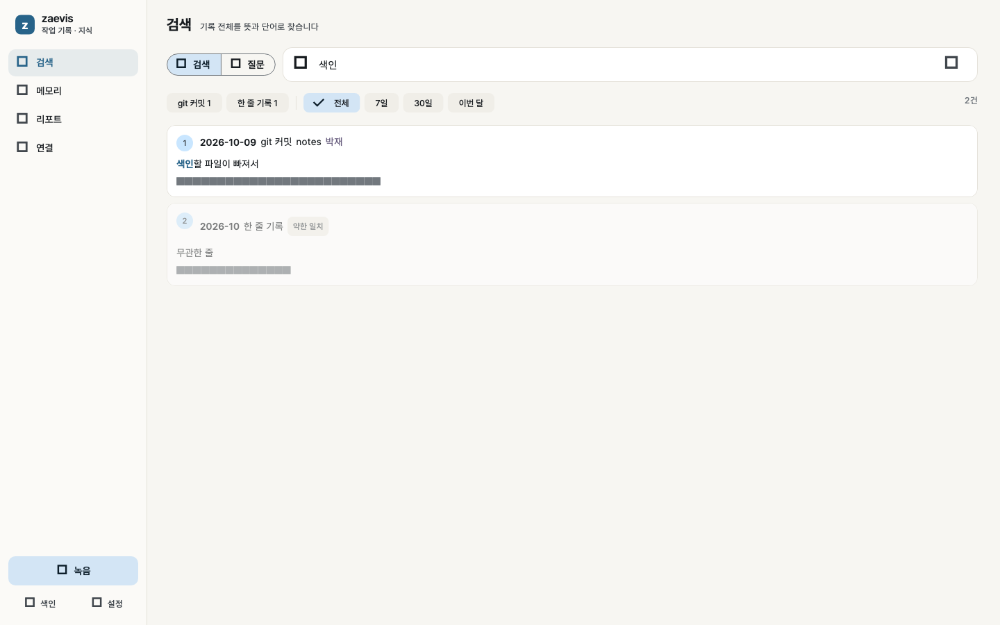
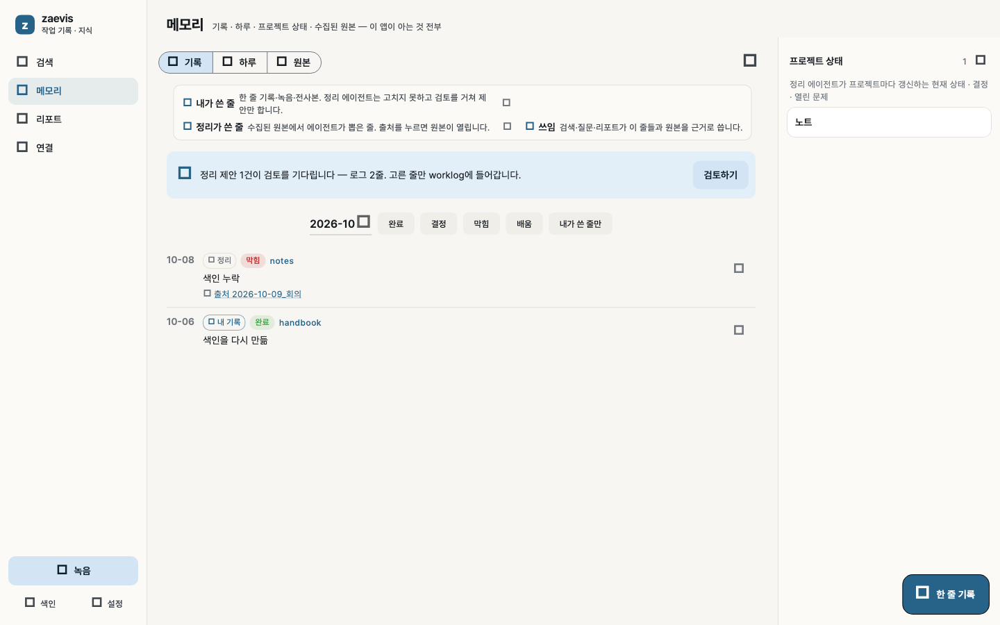
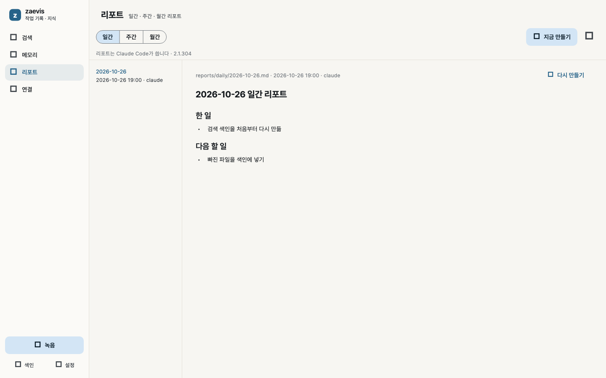
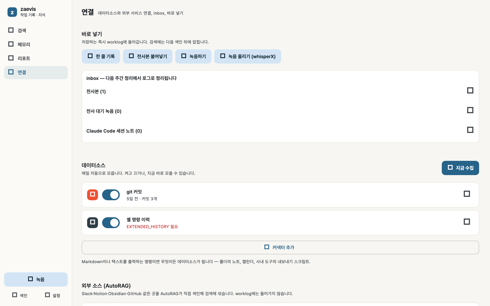

# zaevis

작업 기록을 모아 **개인 지식 베이스**로 쓰는 로컬 앱입니다.

## 화면

검색, 메모리, 리포트, 연결. 넓은 창은 왼쪽 사이드바입니다.









**수집** 매일 18:30에 git 커밋, 에이전트 세션, 셸 명령, 전사본, 커넥터를 모읍니다.

**주입** 한 줄 기록, 전사본, 녹음은 바로 저장됩니다. 녹음은 whisperX가 전사합니다.

**검색** 로컬 [AutoRAG](https://github.com/Marker-Inc-Korea/AutoRAG) Lite입니다. 키워드와 의미 검색을 함께 씁니다. 의미 검색은 처음 켤 때 모델 1.1GB를 받으며, 설정에서 끌 수 있습니다. [Kiwi](https://github.com/bab2min/Kiwi)를 넣으면 한국어 활용형도 찾습니다. 설치 뒤에는 색인을 처음부터 다시 만듭니다.

**질문** 검색된 문단만 근거로 답합니다. 문장마다 출처 번호가 붙고, 이어서 물으면 앞 대화를 기억합니다.

**리포트** 일간, 주간, 월간으로 한 일, 결정, 막힌 것, 다음 할 일을 정리합니다.

**정리** 매주 월요일에 로그와 프로젝트 상태를 갱신합니다. 이 컴퓨터의 Claude Code, Codex, Gemini CLI를 쓰고, 없으면 OpenRouter 키를 씁니다. 자동이면 할당량이 막힌 CLI는 다음으로 넘기고, 하나를 고정하면 그 하나만 씁니다.

**기록 위치** worklog는 이 저장소 밖에 있습니다. 밖으로 나가는 항목은 설정의 **검색 재정렬**뿐입니다. 켜면 검색어와 상위 문단이 OpenRouter로 갑니다.

수집과 주입이 worklog로 모이고, AutoRAG가 색인한 뒤 앱과 CLI에서 검색합니다.

## 설치

[Releases](https://github.com/zae-park/zae-vis/releases)에서 받습니다.

macOS가 앱을 손상됐다고 하면, 설치한 뒤 한 번 실행합니다.

```bash
xattr -dr com.apple.quarantine /Applications/zaevis.app
```

## 명령

```bash
zaevis search 검색 색인
zaevis ask "색인은 왜 미뤘지?"
zaevis add "#decision [[notes]] 색인을 처음부터 다시 만들기로"
zaevis log
zaevis report daily
zaevis index --refresh
zaevis collect
zaevis ingest 회의.txt 녹음.m4a
```

전체 목록은 `zaevis help`입니다. 서버는 필요할 때 `127.0.0.1:4710`에서 스스로 뜹니다.

**직접 넣기**

- 전사본은 `worklog/inbox/transcripts/`에 둡니다.
- 한 줄은 `worklog/log/YYYY-MM.md`에 적습니다.
- 형식은 worklog의 `README.md`에 있습니다.

## 메모리

- **기록** 날짜순 한 줄입니다. **내 기록**은 잠겨 있고, **정리**가 쓴 줄은 출처로 원본을 엽니다.
- **하루** 내가 쓴 줄, 그날의 원본, 정리 결과를 한 카드에 모읍니다.
- **원본** 수집 파일과 전사본입니다. 몇 줄의 근거가 됐는지 보입니다.
- **상태** 프로젝트별 현재 상태, 결정, 열린 문제입니다. 넓은 창에서는 오른쪽에 있습니다.

## 데이터소스

연결 탭에서 켜고 끕니다. 원본에 있던 토큰과 비밀번호는 저장 전에 가립니다.

| 이름 | 모으는 것 |
|---|---|
| `git` | 고른 폴더 아래 커밋. 줄마다 작성자 |
| `agent-sessions` | Claude Code, Codex, Gemini, ChatGPT 내보내기. 요청과 응답, 수정 파일, 명령 |
| `shell-history` | zsh 명령. 시각이 없어도 모으며, 친 시각까지 남기려면 **시각 기록 켜기** |
| `transcripts` | 내보낸 전사와 녹음. 녹음은 whisperX |
| 사용자 커넥터 | Markdown을 출력하는 명령. `{fromDate}` `{toDate}`를 날짜로 바꿉니다 |

**Claude 웹** 대화는 내보낸 파일을 전사본이나 커넥터로 넣습니다.

### 외부 소스

worklog에 복사하지 않고, 검색 결과에 출처로 섞습니다. **설치** 버튼이 필요한 CLI를 넣습니다. 토큰은 카드의 **토큰 값**에만 넣습니다.

| 소스 | 준비 | 입력 |
|---|---|---|
| Obsidian | 없음 | 볼트 폴더 |
| 메일 내보내기 | 없음 | mbox, eml |
| RSS | 없음 | 피드 주소 |
| Spotlight | macOS | 질의, 폴더 |
| GitHub, Gist | 토큰 | `owner/repo` |
| Slack, Notion, Discord, WhatsApp, Telegram | 각 CLI와 로그인 | 워크스페이스 또는 아카이브 |
| 카카오톡 | lazykatok | 아카이브 |
| 메일 | mailcrawl | 계정, 메일함 |
| 클라우드 드라이브 | rclone | 리모트 이름 |
| 사진, 브라우저 기록 | clawgallery, hister | 폴더 또는 주소 |

## 질문과 리포트

**질문** 검색 탭에서 질문으로 전환합니다. 상위 문단만 근거로 씁니다. 근거가 없으면 찾지 못했다고 답합니다. 대화는 `~/.zaevis/ask/`에 남습니다. 결과 위 칩으로 출처와 기간을 거릅니다.

**리포트** 기간 안의 로그만 근거로 씁니다. 파일은 `reports/daily`, `reports/weekly`, 월간은 `summaries/`입니다.

**만들기** 오늘, 어제, 이번 주, 지난주, 이번 달, 지난달 중에서 고릅니다.

**자동** 기본은 매월 1일의 월간입니다. 일간은 전날, 주간은 고른 요일의 지난주, 월간은 지난달을 씁니다.

질문, 리포트, 정리는 같은 에이전트를 씁니다. 로그인이 안 된 CLI는 건너뛰고 화면에 이유를 보여 줍니다.

## 정리

**검토** 기본으로 켜져 있습니다. 에이전트가 쓴 줄은 제안으로 남고, 메모리 탭에서 고른 것만 적용합니다. 기존 줄을 지우지는 않습니다.

**알림** 정리 제안, 수집 실패, 전사 완료를 시스템 알림으로 보냅니다. 앱이 닫혀 있어도 옵니다.

**예약** 매주 월요일 정리는 앱이 돌립니다. Claude 예약 작업을 쓰려면 `~/.zaevis/weekly-task-prompt.md`를 그대로 넣습니다.

## 개발

```bash
cd server && npm install && npm test
cd app && flutter test && flutter analyze
bin/zaevis install && zaevis setup
```

| 경로 | 내용 |
|---|---|
| `bin/zaevis` | CLI |
| `server/` | 로컬 API. Node 24 |
| `app/` | Flutter 앱 |
| `kit/` | worklog 템플릿과 정리 프롬프트 |

설치본은 macOS에서 `tool/package_macos.sh`(DMG), Windows에서 `tool/package_windows.ps1`(설치 exe)입니다. Flutter, protobuf, cmake, Rust가 필요합니다. Kiwi와 임베딩 모델은 설치본에 넣지 않습니다.

GitHub Actions는 push마다 서버 테스트, Flutter 분석과 테스트, macOS와 Windows 앱 빌드를 돌립니다. main에 푸시하면 `app/pubspec.yaml`의 버전으로 설치 파일을 만들고, 같은 버전의 Release가 있으면 파일과 태그를 이번 커밋으로 바꿉니다. `0.1.0+2`의 `+` 뒤는 버전으로 치지 않습니다. 설치한 앱은 시작할 때 이 Release를 보고, 빌드가 더 새로우면 알림을 띄웁니다.

태그, 로그 형식, API는 [docs/customizing.md](docs/customizing.md)에 있습니다.

## 라이선스

MIT. AutoRAG 엔진은 Apache-2.0입니다.
